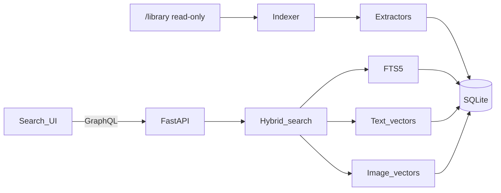

# Lightweight Umbrel Search

A personal search app for umbrelOS 2.0, built in this empty repo and sized for a Ryzen 5 8600G with 32 GB RAM and about 1 TB free. The integrated GPU stays unused: ROCm for that APU inside an Umbrel container is unreliable, and the small ONNX models below fit in RAM and finish a library index in the background on the 12 CPU threads.

## What ships

One container. The web UI, GraphQL API, and indexer are the same process. The index is one SQLite file (FTS5 keywords + sqlite-vec vectors). No Qdrant, Ollama, PyTorch, Docling, or ColPali.

You install it from a community app store in this repo, then in the app’s Umbrel settings attach Home, USB, or network folders read-only at `/library`. The index is stored in the app’s own data directory, separate from those files.




## Models and parsers

Text embeddings: `intfloat/multilingual-e5-small` (384 dimensions) through fastembed ONNX. Queries use the `query:` prefix and passages use `passage:`.

Photos: fastembed CLIP ViT-B/32. One vector per image. The search query is embedded with the CLIP text tower so “red bike” can match a photo. Camera EXIF is stored as date metadata. Screenshots and scans (no camera EXIF) also get a Tesseract pass. Photos taken by a camera skip OCR.

Documents, with no layout model:

- PDF text via pypdf, page by page. If a page has almost no text, render it with pypdfium2 and OCR that page.
- DOCX, PPTX, XLSX, ODT, RTF, HTML, CSV, TXT, Markdown, EPUB with the matching lightweight parser. Office files are zip containers and still get indexed. Generic archives do not.
- One chunk per slide for PPTX. Other text is packed to about 800 characters with a short overlap.

Files over 100 MB are recorded as skipped. Junk names are skipped without hashing: `.DS_Store`, `Thumbs.db`, `desktop.ini`, `System Volume Information`, `$RECYCLE.BIN`, `.Trashes`, `.Spotlight-V100`, `.fseventsd`. Type is decided with libmagic, then an allowlist. Videos, generic zip/7z/rar/tar, executables, and unknown binaries are skipped on stat alone so walking 2 TB of media stays cheap.

Changed files are detected with size and mtime, then an xxhash when those differ. Removed files are dropped on a reconcile pass. The walker is a single background thread with embedding batches of 32, SQLite WAL so search stays readable while indexing.

v1 does not run a cross-encoder reranker. Keyword rank and vector rank are merged with reciprocal rank fusion (k = 60). That is the CPU-cheap version of hybrid search. A reranker can be added later if the top hits are weak.

## GraphQL

Strawberry on FastAPI at `POST /graphql`. The UI polls. No subscriptions.

```graphql
type Query {
  search(q: String!, fileType: FileType, folder: String, limit: Int = 20): SearchResult!
  status: IndexStatus!
  file(path: String!): FileDetail
}

enum FileType { ALL DOCUMENT IMAGE }
```

`search` returns path, name, file type, page or slide, snippet, and fused score. `status` returns walker state plus seen, indexed, skipped, and failed counts. `file` returns metadata for one sandboxed path.

Image and PDF bytes are not stuffed into GraphQL. One route, `GET /content?path=`, streams a file only if the resolved path stays under `/library`. The UI uses it for thumbnails.

## Repo layout

- [umbrel-app-store.yml](umbrel-app-store.yml) with store id `better`
- [better-search/umbrel-app.yml](better-search/umbrel-app.yml) app id `better-search`, version `0.1.0`, port `8787`
- [better-search/docker-compose.yml](better-search/docker-compose.yml) with `app_proxy` host `better-search_app_1` and a read-write mount `${APP_DATA_DIR}/data:/data`. `/library` is attached later in Umbrel app settings, read-only
- [better-search/Dockerfile](better-search/Dockerfile) multi-stage: bun builds the UI, uv installs the Python app, runtime is `python:3.12-slim` plus tesseract
- Python package in [better-search/src/better_search/](better-search/src/better_search/) (`classify`, `extract`, `embed`, `db`, `indexer`, `search`, `schema`, `main`)
- UI in [better-search/web/](better-search/web/) with bun, Vite, React, and framer-motion: a search field, document/photo filter, animated results, snippet, path, and an indexing status line
- Tests in [better-search/tests/](better-search/tests/)

Tests use a deterministic fake embedder so they do not download models. They cover the allowlist and junk names, PDF/DOCX/PPTX extraction on tiny fixtures, chunking, RRF, incremental skip-if-unchanged, GraphQL search, and path traversal on `/content`. `uv run pytest` is the check.

Before dependencies are locked, scan them with Socket. Python and bun are both in scope. If Socket cannot score one of them, stop and report that.

Local run: `LIBRARY_PATH` pointed at a fixture folder, `uv run` the API, `bun run dev` for the UI. The Umbrel image is what runs on the server.


Ensure the system indexes all existing files, and any new files. Ensure that the new files have to be on the main system, external drives are not indexed

## Install on the Umbrel

Push this repo, then on umbrelOS: App Store, three dots, Community App Stores, paste the GitHub URL, install Search. In the app’s settings, add each library folder to the `app` service at `/library`, read-only. First start downloads the two small ONNX models into app data (needs network once). The UI is served through Umbrel login.