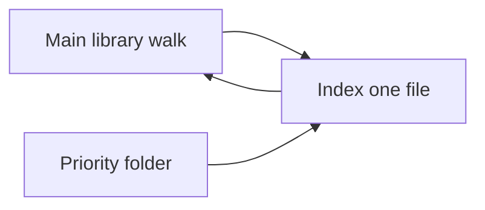

# Search score, better model, folder priority

## Model choice

The current text model, `sentence-transformers/paraphrase-multilingual-MiniLM-L12-v2` in [better-search/src/better_search/config.py](better-search/src/better_search/config.py), is a 2021 paraphrase model (384 dimensions). It is not trained for retrieval.

Compared on MTEB multilingual retrieval (Qwen’s May 2025 table) and the later MMTEB multilingual board:

- Qwen3-Embedding-8B retrieval 70.88 and 4B retrieval 69.60 are the quality ceiling. Both are too large to embed a home disk on an Umbrel CPU.
- **Qwen3-Embedding-0.6B** is the best model that still fits: retrieval **64.64**, multilingual mean **64.33**, 1024 dimensions, 32k context, 100+ languages, Apache-2.0. INT8 ONNX is about 613 MB.
- multilingual-e5-large-instruct retrieval is 57.12. EmbeddingGemma-300M multilingual mean is 61.15 and uses the Gemma license. Both lose to the 0.6B Qwen model.
- FastEmbed 0.9.0 (already in [better-search/uv.lock](better-search/uv.lock)) does not ship Qwen3. The FastEmbed PR that added it was closed unmerged. Load `onnx-community/Qwen3-Embedding-0.6B-ONNX` (`onnx/model_quantized.onnx`) with ONNX Runtime, tokenizers, and huggingface-hub, which are already locked. Socket scores for those packages are fine (onnxruntime supply-chain 73, everything else 90–100). No new packages.

Queries use the model’s instruction prefix. Passages stay raw text, still prefixed with the file name as they are today:

`Instruct: Given a file search query, retrieve relevant passages from personal documents and notes\nQuery:{query}`

Photo search stays a separate shared text/image space. FastEmbed 0.9.0’s best complete upgrade over CLIP ViT-B/32 is `**jinaai/jina-clip-v1**` (768 dimensions, multilingual, Apache-2.0). The vision ONNX is already registered. The matching text tower is not in FastEmbed’s text registry, so register it with `TextEmbedding.add_custom_model` (`output_name` exists in 0.9.0) against `onnx/text_model.onnx` in the same repo. If that tower does not emit a 768-d vector, keep `Qdrant/clip-ViT-B-32-vision` plus `Qdrant/clip-ViT-B-32-text` so “red bike” search still works. Qwen3-VL-Embedding-2B is stronger and too heavy to index a photo library here.

A Qwen3 reranker was rejected: a second 0.6B model would sit on the same CPU that is indexing.

## Reset is allowed for the new vectors, but best if not

[better-search/src/better_search/db.py](better-search/src/better_search/db.py) already drops `vec_text` / `vec_image`, clears chunks and FTS, and marks indexed files `pending` when a dimension changes. 384→1024 (text) and 512→768 (images, if Jina CLIP loads) take that path. The next scan re-extracts and re-embeds. Keyword search is empty until that rebuild finishes. That is the accepted trade for the new model. Tests keep `FakeEmbedder` and never download weights.

## Similarity next to the path

`Hit.score` is reciprocal rank fusion (about 0.01–0.05), drawn as a bar relative to the top hit in [better-search/web/src/App.jsx](better-search/web/src/App.jsx). Ranking stays RRF across keyword, text, and image lists in [better-search/src/better_search/search.py](better-search/src/better_search/search.py).

Add `similarity` (cosine, 0–1). sqlite-vec is already cosine, so similarity is `1 - distance`. `vec_ids` returns `(chunk_id, similarity)`. For a hit that only came from keyword search, load that row’s vector and dot it with the query vector (vectors are already L2-normalized). Expose `similarity` on the GraphQL `SearchHit`.

In the result row, show the percent beside the path (`86%`) and drive the bar from that absolute value, not from the best RRF score.

## Prioritize a folder without restarting the walk

The scan in [better-search/src/better_search/indexer.py](better-search/src/better_search/indexer.py) is one `for path in iter_library_files(...)` loop. Do not call `full_scan()` again, do not mint a new `scan_token`, and do not zero the counters.

- Add `Indexer.prioritize(relative) -> str`. Reject paths outside the library, `..`, and other devices (same rules as the walker).
- Store one pending folder. Between files in `full_scan`, and on each pass of the watching loop, if a folder is pending, walk only that folder with `iter_library_files` and `_index_one` those files, then continue the original walk. Files already done are skipped by the existing unchanged check when the main walk reaches them.
- GraphQL mutation `prioritizeFolder(path: String!): String` and `priorityFolder` on `IndexStatus`.
- UI: a short field, “Index this folder first”, under the filters. Status line names the folder while it is queued. Use the existing framer-motion patterns.

## Tests

- Search returns `similarity` in 0–1 for a known hit, and the UI query requests it.
- `prioritize("z")` before `full_scan` indexes `z/` before `a/` without changing `scan_token` mid-walk. A priority requested after the first file is indexed next, and counters are not reset.
- Model-id / instruct-prefix unit test with no ONNX download. Dimension-mismatch behavior stays covered by the existing pending-status migration.
- `uv run pytest` in `better-search`.

